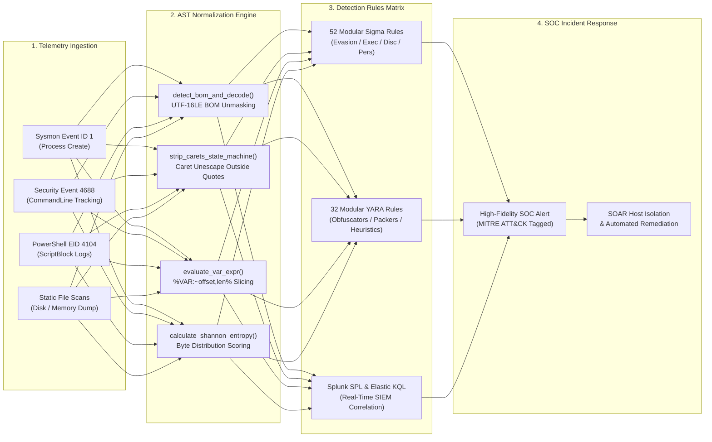

<div align="center">

<p align="center">
  <strong>🇺🇸 English</strong> · <a href="./docs/locales/ko.md">🇰🇷 한국어</a> · <a href="./docs/locales/zh-CN.md">🇨🇳 中文</a> · <a href="./docs/locales/es.md">🇪🇸 Español</a> · <a href="./docs/locales/hi.md">🇮🇳 हिन्दी</a><br />
  <a href="./docs/locales/ar.md">🇸🇦 العربية</a> · <a href="./docs/locales/pt-BR.md">🇧🇷 Português</a> · <a href="./docs/locales/ru.md">🇷🇺 Русский</a> · <a href="./docs/locales/fr.md">🇫🇷 Français</a> · <a href="./docs/locales/id.md">🇮🇩 Bahasa Indonesia</a>
</p>

<p align="center">
  <a href="https://github.com/maya-thorne/batch-forensics-and-ghidra-re"></a>
</p>

# 🛡️ batch-forensics-and-ghidra-re

**Blue Team EDR/SIEM Detection Engineering, 52 Sigma Rules, 32 YARA Signatures & Parser Forensics**

[](https://github.com/maya-thorne/batch-forensics-and-ghidra-re/releases/latest)
[](./rules/sigma)
[](./rules/yara)
[](./rules/siem_queries)
[](./docs/MITRE_ATTACK_DEFENSE_MATRIX.md)
[](./tests)
[](./LICENSE)

<sub>Engineered &amp; Audited by **[Maya Thorne](https://github.com/maya-thorne)** · Systems &amp; Detection Engineering Research</sub>

</div>

---

## 📌 Executive Overview

Windows batch scripting (`cmd.exe`) features one of the most complex command interpreters in enterprise environments. Adversaries and red teams exploit `cmd.exe` non-linear multi-pass parsing quirks—including caret (`^`) interleaving, variable substring slicing (`%VAR:~offset,len%`), and delayed exclamation expansion (`!VAR!`)—to blind pattern-matching endpoint sensors.

This repository is an **enterprise-grade defensive security engineering lab and SOC/EDR detection suite**. It delivers:
1. **52 Modular Production Sigma Rules**: Comprehensive coverage across Defense Evasion (24), Execution (12), Discovery (10), and Persistence (6) mapped to Sysmon Event ID 1 and Security Event 4688.
2. **32 Modular YARA Rules**: Granular static byte signatures targeting known obfuscators (12), compiled PE containers (10), and statistical anomaly heuristics (10).
3. **Turnkey SIEM Query Feeds**: Production Splunk SPL (`rules/siem_queries/splunk_queries.spl`) and Elasticsearch Kibana KQL (`rules/siem_queries/elastic_kql_queries.kql`) ready for instant SOC dashboard deployment.
4. **Statistical Entropy & Caret Density Scorer**: Pure static analysis engine (`src/entropy_detector.py`) calculating Shannon Entropy, Caret Ratio, and delimiter skew with automated unit tests (`tests/test_entropy_detector.py`).
5. **MITRE ATT&CK Enterprise Matrix**: Formal defense mapping matrix in [`docs/MITRE_ATTACK_DEFENSE_MATRIX.md`](./docs/MITRE_ATTACK_DEFENSE_MATRIX.md).
6. **Defensive 5-Stage AST Simulator**: Zero-execution command unescaper (`src/cmd_parser_simulator.py`) for safe in-memory triage.

---

## 🏗️ Blue Team EDR/SIEM Detection Pipeline

<p align="center">
  <a href="https://github.com/maya-thorne/batch-forensics-and-ghidra-re"></a>
</p>

<p align="center">
  <a href="https://github.com/maya-thorne/batch-forensics-and-ghidra-re"></a>
</p>



---

## 💻 Interactive Parser Simulator Live Demo

<p align="center">
  <a href="https://github.com/maya-thorne/batch-forensics-and-ghidra-re"></a>
</p>

---

## 🛡️ Rule Suite Architecture (52 Sigma & 32 YARA)

### 1. Modular Sigma Rules Breakdown (`rules/sigma/`)
- 📁 **[defense_evasion/](./rules/sigma/defense_evasion/) (24 Rules)**:
  - Caret character interleaving (`proc_creation_win_cmd_caret_interleaving.yml`)
  - Double caret escape density (`proc_creation_win_cmd_double_caret_escaping.yml`)
  - Single-character harvesting slices (`proc_creation_win_cmd_env_slicing_single_char.yml`)
  - Negative offset slices (`proc_creation_win_cmd_env_slicing_negative_offset.yml`)
  - Inline string substitution stripping (`proc_creation_win_cmd_string_substitution_strip.yml`)
  - Delayed expansion enabled via `/V:ON` (`proc_creation_win_cmd_delayed_expansion_flag.yml`)
  - Exclamation mark expansion density (`proc_creation_win_cmd_delayed_var_expansion.yml`)
  - Delimiter collapsing via commas, semicolons, and equals signs (`proc_creation_win_cmd_comma_delimiter_collapsing.yml`, etc.)
  - Reversed numeric FOR loop reconstruction (`proc_creation_win_cmd_reversed_for_loop.yml`)
  - Polyglot BatCloak UTF-16LE BOM bypass (`proc_creation_win_cmd_batcloak_polyglot_bom.yml`)
  - ScrubCrypt stage 1 loader bootstrap (`proc_creation_win_cmd_scrubcrypt_stage1_bootstrap.yml`)
  - Somalifuscator Caesar shift decoder (`proc_creation_win_cmd_somalifuscator_caesar_decoder.yml`)
  - 0xidiz3r zero-literal bootstrap pattern (`proc_creation_win_cmd_0xidiz3r_zero_literal.yml`)
  - Certutil silent decode pipelines (`proc_creation_win_cmd_certutil_decode_hidden.yml`)
  - Forfiles, Pcalua, and Rundll32 indirect batch execution rules.
- 📁 **[execution/](./rules/sigma/execution/) (12 Rules)**:
  - Output suppression (`/Q`), STDIN piping, console device redirection (`\\.\con`), clipboard staging (`clip.exe`), base64 PowerShell spawns, cscript VBS staging, inline mshta, regsvr32 scrobj, and wmic process calls.
- 📁 **[discovery/](./rules/sigma/discovery/) (10 Rules)**:
  - Anti-VM MAC address scanning, localhost ping delay evasion, virtualization checks, tasklist debugger discovery, domain trust enumeration, and privilege discovery.
- 📁 **[persistence/](./rules/sigma/persistence/) (6 Rules)**:
  - Registry Run key additions, Startup folder drops, Windows service creation (`sc create`), WMI event subscriptions, COR profiler DLL hijacking, and AppInit_DLLs tampering.

### 2. Modular YARA Rules Breakdown (`rules/yara/`)
- 📁 **[obfuscators/](./rules/yara/obfuscators/) (12 Rules)**:
  - `Invoke-DOSfuscation`, `BatCloak`, `ScrubCrypt`, `Somalifuscator` V1 & V2, `0xidiz3r`, `Abobus`, `BatchAlchemy`, `BEncoder`, `PandaCrypter`, `Invoke-CradleCrafter`, and `Batch-Dump`.
- 📁 **[packers/](./rules/yara/packers/) (10 Rules)**:
  - Bat2Exe UPX native containers, VB6 `ThunRTMain` stubs, .NET CLR resource unpackers, Bytepress LZMA RangeCoder decompressors, F2KO software converters, and PE overlay XOR stubs.
- 📁 **[heuristics/](./rules/yara/heuristics/) (10 Rules)**:
  - High caret density, excessive variable slicing, Certutil hex decode chains, reversed FOR loop reconstruction, delimiter collapsing, dynamic substitution tables, anti-VM hardware fingerprinting, Shannon entropy thresholds, PowerShell download cradles, and in-memory AMSI/ETW byte patching.

---

## ⚡ Instant SIEM Query Deployment

### Splunk SPL Snippet (`rules/siem_queries/splunk_queries.spl`)
```spl
index=windows sourcetype="XmlWinEventLog:Microsoft-Windows-Sysmon/Operational" EventCode=1
| regex CommandLine="\^([a-zA-Z0-9_\-\.]\^){2,}"
| stats count, values(CommandLine) by host, User, ParentImage, Image
```

### Elastic KQL Snippet (`rules/siem_queries/elastic_kql_queries.kql`)
```kql
event.category: "process" and process.name: "cmd.exe" and process.command_line: /.*(%[a-zA-Z0-9_]+:~[0-9]+,1%){3,}.*/
```

---

## 🔬 Statistical Anomaly Scorer & Tests

```bash
# Run the automated unit tests verifying the anomaly scorer and parser simulator
python -m unittest discover tests
```

```python
from src.entropy_detector import analyze_script_telemetry

with open("tests/samples/parser-test-vectors/01_env_slicing_sample.bat", "rb") as f:
    result = analyze_script_telemetry(f.read())

print(f"Shannon Entropy : {result.shannon_entropy}")
print(f"Threat Level    : {result.threat_level}")
print(f"Composite Score : {result.composite_threat_score}/100.0")
print(f"Anomalies       : {result.triggered_anomalies}")
```

---

## 📁 Repository Directory Structure

```text
batch-forensics-and-ghidra-re/
├── docs/                                        # Whitepapers, locales & visual assets
│   ├── assets/                                  # Hero SVG banners & detection pipeline diagrams
│   ├── locales/                                 # 9 translated documentation summaries
│   └── MITRE_ATTACK_DEFENSE_MATRIX.md           # Formal MITRE ATT&CK 15-technique matrix
├── references/                                  # 41 clean flattened open-source mirrors
├── rules/                                       # 52 Sigma & 32 YARA production rulesets
│   ├── sigma/                                   # 52 Modular Rules (evasion, exec, disc, persist)
│   ├── yara/                                    # 32 Signatures (obfuscators, packers, heuristics)
│   └── siem_queries/                            # Production Splunk SPL & Elastic KQL feeds
├── src/                                         # Statistical anomaly detector & AST simulator
├── tests/                                       # Automated test suites & test vectors
│   ├── samples/                                 # 6 benign educational test vectors
│   ├── test_entropy_detector.py                 # Anomaly scoring test suite
│   └── test_cmd_parser_simulator.py             # AST simulator test suite
├── memory/                                      # Worker context and task records
├── LICENSE                                      # Maya Thorne Systems & Security Research License (MT-SRL)
└── README.md                                    # Root bilingual research overview
```

---

## ⚖️ Legal & Ethical Notice

This repository is maintained strictly for **defensive computer security research, enterprise detection engineering, parser correctness verification, and blue-team education**. All batch samples included in `tests/samples/parser-test-vectors/` are benign test scripts that perform no malicious operations (printing educational demonstration strings such as `Hello World`).

---

<div align="center">
<sub>Maintained with precision by <strong><a href="https://github.com/maya-thorne">Maya Thorne</a></strong> · Blue Team &amp; Detection Engineering</sub>
</div>
