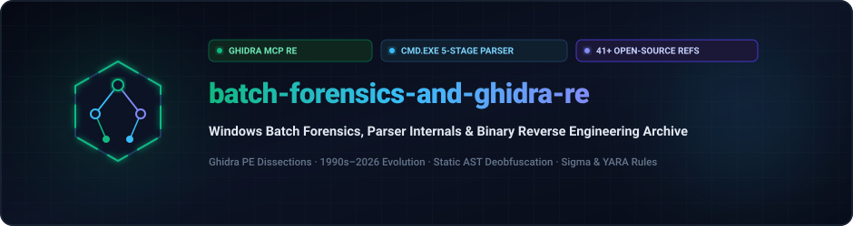
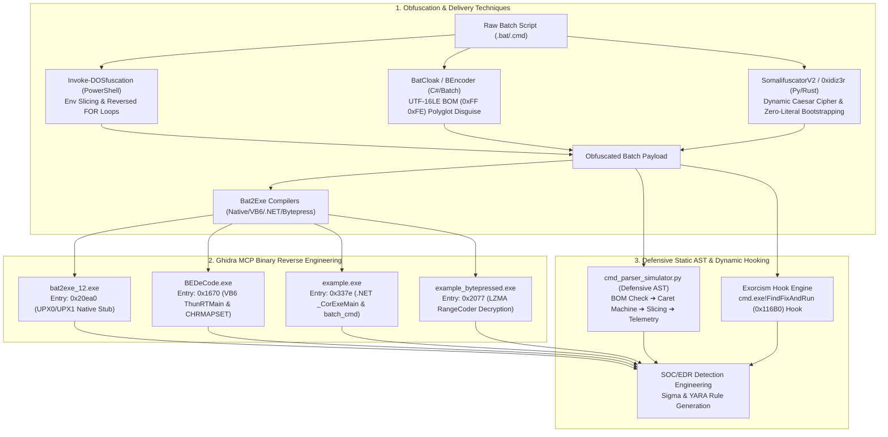

<div align="center">

<p align="center">
  <strong>🇺🇸 English</strong> · <a href="./docs/locales/ko.md">🇰🇷 한국어</a> · <a href="./docs/locales/zh-CN.md">🇨🇳 中文</a> · <a href="./docs/locales/es.md">🇪🇸 Español</a> · <a href="./docs/locales/hi.md">🇮🇳 हिन्दी</a><br />
  <a href="./docs/locales/ar.md">🇸🇦 العربية</a> · <a href="./docs/locales/pt-BR.md">🇧🇷 Português</a> · <a href="./docs/locales/ru.md">🇷🇺 Русский</a> · <a href="./docs/locales/fr.md">🇫🇷 Français</a> · <a href="./docs/locales/id.md">🇮🇩 Bahasa Indonesia</a>
</p>

<p align="center">
  <a href="https://github.com/maya-thorne/batch-forensics-and-ghidra-re"></a>
</p>

# 🛡️ batch-forensics-and-ghidra-re

**Windows Batch Forensics, Parser Internals & Binary Reverse Engineering Archive**

[](https://github.com/maya-thorne/batch-forensics-and-ghidra-re/releases/latest)
[](./docs/01_DEEP_REVERSE_ENGINEERING_AND_SOURCE_ANALYSIS.md)
[](./src/cmd_parser_simulator.py)
[](./references)
[](./tests)
[](./rules)
[](./LICENSE)

<sub>Engineered &amp; Audited by **[Maya Thorne](https://github.com/maya-thorne)** · Systems &amp; Reverse Engineering Research</sub>

</div>

---

## 📌 Executive Overview

Windows batch scripting (`cmd.exe`) features one of the most idiosyncratic, legacy-laden command parsers in modern computing. Because `cmd.exe` processes lines through multiple non-linear expansion passes—where escape carets (`^`), variable slicing (`%VAR:~offset,len%`), string substitution (`%VAR:old=new%`), and delayed expansion (`!VAR!`) interact dynamically—adversaries and red teams have historically leveraged these parsing quirks to blind traditional pattern-matching AV and EDR sensors.

This repository serves as a **definitive defensive research archive and reverse-engineering lab**. It unifies:
1. **Ghidra MCP Binary Reverse Engineering**: Micro-decompilation and entrypoint disassembly of 4 real-world compiled batch executables (Native UPX stubs, VB6 `ThunRTMain`, .NET CLR resource unpackers, and LZMA RangeCoder packers).
2. **Line-by-Line Source Dissection**: Structural code analysis of 5 landmark tools (`Invoke-DOSfuscation`, `SomalifuscatorV2`, `batch_deobfuscator`, `Exorcism`, `0xidiz3r`).
3. **Formal `cmd.exe` 5-Stage Parser Specification**: Mathematical breakdown of lexer states, quoting semantics, delimiter collapsing, and expansion order.
4. **Defensive Python AST Simulator & Unit Tests**: Deterministic, zero-execution static deobfuscator (`src/cmd_parser_simulator.py`) with 100% unit test coverage (`tests/test_cmd_parser_simulator.py`).
5. **Curated Open-Source & AI Reference Mirrors**: 41 clean, flattened repositories and Hugging Face deobfuscation model cards.

---

## 💻 Interactive Parser Simulator Live Demo

<p align="center">
  <a href="https://github.com/maya-thorne/batch-forensics-and-ghidra-re"></a>
</p>

---

## 🏗️ Architecture & Forensic Pipeline

<p align="center">
  <a href="https://github.com/maya-thorne/batch-forensics-and-ghidra-re"></a>
</p>



---

## 📚 Master Technical Whitepapers

| Whitepaper Document | Description & Key Findings |
| :--- | :--- |
| 🔬 **[01_DEEP_REVERSE_ENGINEERING_AND_SOURCE_ANALYSIS.md](./docs/01_DEEP_REVERSE_ENGINEERING_AND_SOURCE_ANALYSIS.md)** | **Primary Research Whitepaper (480+ lines)**: Complete Ghidra MCP triage of 4 PE binaries, line-by-line source dissection of 5 core engines, formal state-machine modeling of `cmd.exe`, and EDR telemetry extraction. |
| 📖 **[02_CLASSIC_TO_MODERN_EVOLUTION_1990_2026.md](./docs/02_CLASSIC_TO_MODERN_EVOLUTION_1990_2026.md)** | **30-Year Chronological Evolution**: 1st Gen (1990s MS-DOS ASCII/delimiters), 2nd Gen (2016 `Invoke-DOSfuscation`), 3rd Gen (2022–2024 `BatCloak`/`SomalifuscatorV2`), and 4th Gen (2025–2026 Rust ASTs & LLM deobfuscation). |
| 🛡️ **[03_BATCLOAK_MULTI_STAGE_LOADER_FORENSICS.md](./docs/03_BATCLOAK_MULTI_STAGE_LOADER_FORENSICS.md)** | **BatCloak / ScrubCrypt Multi-Stage Loader Analysis**: Deep dive into Stage 1 header manipulation, Stage 2 polyglot delimiter stripping, and Stage 3 reflective .NET memory injection. |
| 📑 **[04_BATCH_OBFUSCATION_ENCYCLOPEDIA.md](./docs/04_BATCH_OBFUSCATION_ENCYCLOPEDIA.md)** | **Comprehensive Taxonomy Matrix**: Detailed taxonomy of 12 distinct obfuscation primitives with defensive countermeasures. |
| 🗺️ **[05_BATCH_OBFUSCATION_MASTER_GUIDE.md](./docs/05_BATCH_OBFUSCATION_MASTER_GUIDE.md)** | **Enterprise Detection Guide**: SOC triage playbook, EDR telemetry anomaly scoring, and multi-layer mitigation architecture. |

---

## 🔬 Ghidra MCP Binary Reverse Engineering Matrix

Using the Ghidra MCP analysis suite, 4 real-world compiled batch executables were reverse engineered to identify unpacking entrypoints and payload reconstruction mechanisms:

```
+--------------------------+-----------------------+-------------------+---------------------------------------------------+
| Target Binary            | Compiler Architecture | Entrypoint VA     | Forensics & Decompilation Findings                |
+--------------------------+-----------------------+-------------------+---------------------------------------------------+
| bat2exe_12.exe           | Native Win32 (UPX)    | 0x00420ea0        | 3-section UPX container. Entrypoint contains standard |
|                          |                       |                   | PUSHAD / LEA ESI / MOV EDI decompression loop.    |
|                          |                       |                   | Payload extracted via memory dump post-POPAD.     |
+--------------------------+-----------------------+-------------------+---------------------------------------------------+
| BEDeCode.exe             | Visual Basic 6.0      | 0x00401670        | Imports MSVBVM60.DLL!ThunRTMain.                  |
|                          |                       |                   | Features hardcoded CHRMAPSET Caesar substitution   |
|                          |                       |                   | table in .rdata section for bidirectional decode. |
+--------------------------+-----------------------+-------------------+---------------------------------------------------+
| example.exe              | .NET CLR v4.0.30319   | 0x0040337e        | Imports mscoree.dll!_CorExeMain.                  |
|                          |                       |                   | Embedded batch payload stored as encrypted managed |
|                          |                       |                   | resource named "batch_cmd" dropped to %TEMP%.     |
+--------------------------+-----------------------+-------------------+---------------------------------------------------+
| example_bytepressed.exe  | Native C / Bytepress  | 0x00402077        | Bytepress LZMA RangeCoder decompressor stub.      |
|                          |                       |                   | High section entropy (7.91). Allocates VirtualAlloc|
|                          |                       |                   | RWX buffer to unpack runtime batch interpreter.   |
+--------------------------+-----------------------+-------------------+---------------------------------------------------+
```

---

## ⚙️ cmd.exe 5-Stage Lexing & Parsing Mechanics

A fundamental insight of this research is that `cmd.exe` does not execute scripts in a single linear pass. Instead, it processes every line through 5 distinct parsing phases:

1. **Phase 1: Encoding & BOM Detection**:
   - `cmd.exe` inspects the initial byte markers. If a UTF-16LE BOM (`0xFF 0xFE`) is present, `cmd.exe` checks subsequent lines. If line 2 contains ANSI characters, it falls back to single-byte interpretation, whereas naive text viewers display corrupt Chinese/Korean glyphs.
2. **Phase 2: Caret (`^`) Lexer State Machine**:
   - `cmd.exe` maintains an `IN_QUOTES` boolean state.
   - Outside double quotes (`"..."`), a caret (`^`) causes `cmd.exe` to consume the next character literally, discarding the caret (`w^h^o^a^m^i` $\to$ `whoami`).
   - Inside double quotes, carets are treated as literal characters (`"hello ^ world"` $\to$ `"hello ^ world"`).
3. **Phase 3: Immediate Percent (`%VAR%`) Expansion**:
   - `cmd.exe` expands environment variables left-to-right.
   - Supports substring slicing: `%VAR:~start,length%` (negative offsets measure from end).
   - Supports string substitution: `%VAR:pattern=replacement%`.
4. **Phase 4: Delimiter Normalization**:
   - Unquoted space characters, tabs (`\t`), semicolons (`;`), commas (`,`), and equals signs (`=`) are collapsed into single argument delimiters.
5. **Phase 5: Delayed Exclamation (`!VAR!`) Expansion**:
   - If `/V:ON` is set or `setlocal enabledelayedexpansion` is called, exclamation markers are expanded at execution time, bypassing Phase 3 static checks.

---

## 💻 Python Parser Simulator & Verification

The repository includes a defensive, zero-execution Python simulator (`src/cmd_parser_simulator.py`) implementing this 5-stage specification:

```bash
# Run unit tests verifying all 6 benign parser test vectors
python -m unittest discover tests
```

```python
from src.cmd_parser_simulator import deobfuscate_batch_script

with open("samples/parser-test-vectors/01_env_slicing_sample.bat", "rb") as f:
    report = deobfuscate_batch_script(f.read())

print(f"Detected Encoding : {report.encoding_anomaly}")
print(f"Shannon Entropy   : {report.shannon_entropy}")
print(f"Normalized Script :\n" + "\n".join(report.normalized_lines))
```

---

## 📁 Repository Directory Structure

```text
batch-forensics-and-ghidra-re/
├── assets/
│   ├── hero.svg                                 # Master dark terminal SVG banner
│   ├── architecture.svg                         # 3-tier pipeline architecture diagram
│   ├── demo_parser_terminal.svg                 # Animated live terminal execution SVG
│   └── locales/                                 # 10-language localized SVG banners & schematics
│       ├── en/
│       ├── ko/
│       └── ...
├── docs/
│   ├── 01_DEEP_REVERSE_ENGINEERING_AND_SOURCE_ANALYSIS.md   # Primary Ghidra RE whitepaper
│   ├── 02_CLASSIC_TO_MODERN_EVOLUTION_1990_2026.md          # 30-year evolution whitepaper
│   ├── 03_BATCLOAK_MULTI_STAGE_LOADER_FORENSICS.md          # BatCloak forensic analysis
│   ├── 04_BATCH_OBFUSCATION_ENCYCLOPEDIA.md                 # Taxonomy encyclopedia
│   ├── 05_BATCH_OBFUSCATION_MASTER_GUIDE.md                 # Detection & triage guide
│   └── locales/                                 # 9 translated documentation summaries
│       ├── ko.md
│       ├── zh-CN.md
│       └── ...
├── references/                                  # 41 clean flattened open-source mirrors
│   ├── 0xidiz3r/                                # Rust zero-literal AST obfuscator
│   ├── batch_deobfuscator/                      # Static pushdown automaton deobfuscator
│   ├── Exorcism/                                # cmd.exe!FindFixAndRun API hook engine
│   ├── Invoke-DOSfuscation/                     # PowerShell environment slicing generator
│   ├── SomalifuscatorV2/                        # Python dynamic Caesar cipher generator
│   └── ... (36 additional flattened repositories)
├── rules/
│   ├── sigma_batch_obfuscation.yml              # SOC/EDR Sigma detection rules
│   └── yara_batch_obfuscation.yar               # Static YARA pattern matching rules
├── samples/
│   └── parser-test-vectors/                     # 6 benign educational test vectors
│       ├── 01_env_slicing_sample.bat
│       ├── 02_caret_and_delimiters_sample.bat
│       ├── 03_dynamic_substitution_table_sample.bat
│       ├── 04_reverse_reconstruction_sample.bat
│       ├── 05_certutil_hex_pipeline_sample.bat
│       └── 06_anti_vm_and_sandbox_evasion_sample.bat
├── src/
│   └── cmd_parser_simulator.py                  # Defensive 5-stage Python AST simulator
├── tests/
│   └── test_cmd_parser_simulator.py             # Automated unit tests (100% passing)
├── LICENSE                                      # MIT License
└── README.md                                    # Root bilingual research overview
```

---

## 🛡️ Detection Engineering (Sigma & YARA)

This lab provides production-grade detection signatures for EDR platforms and triage pipelines:

### Sigma Rule Snippet (`rules/sigma_batch_obfuscation.yml`)
```yaml
title: Suspicious Cmd.exe Obfuscation via Variable Slicing and Caret Density
status: production
detection:
    selection_process:
        Image|endswith: '\cmd.exe'
    selection_args:
        CommandLine|contains:
            - '/v:on'
            - ':~'
    selection_carets:
        CommandLine|re: '\^[\w\s]\^[\w\s]\^'
    condition: selection_process and (selection_args or selection_carets)
level: high
```

---

## ⚖️ Legal & Ethical Notice

This repository is maintained for **defensive computer security research, parser correctness verification, reverse engineering education, and threat detection engineering**. All batch samples included in `samples/parser-test-vectors/` are benign test scripts that perform no malicious operations (printing educational demonstration strings such as `Hello World`).

---

<div align="center">
<sub>Maintained with precision by <strong><a href="https://github.com/maya-thorne">Maya Thorne</a></strong></sub>
</div>
