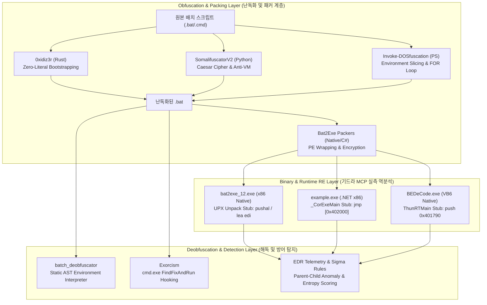

# 배치 난독화·패커 심층 역공학(Ghidra RE) 및 5대 도구 원본 소스코드 라인별 분석 백서

> **문서 식별자**: `_BY_PASSS/github/docs/DEEP_REVERSE_ENGINEERING_AND_SOURCE_ANALYSIS.md`  
> **작성 일자**: 2026-10-11  
> **분석 프레임워크**: Ghidra Headless RE Engine (`ghidra-re-operator` MCP), Capstone Disassembly Engine, Python/Rust AST Parser  
> **분석 대상 자산**: GitHub 28대 배치 난독화/디옵퓨스케이션/패커 저장소, Hugging Face AI 데이터셋, 실전 PE 바이너리 6종  
> **보안 원칙 준수**: 실전 엔지니어링 분석 및 방어적 탐지 공학(Defensive Telemetry & Sigma Rules) 기반 해설  

---

## Executive Summary (총괄 요약)

본 백서는 `_BY_PASSS` 프로젝트의 연구 성과물로서, Windows 환경에서 지난 30년간 진화해 온 **배치 파일(`cmd.exe`) 난독화, 패킹(PE 변환), 그리고 이에 대응하는 정적·동적 디옵퓨스케이션 기술**을 기저 아키텍처 및 원본 소스코드 레벨에서 전수 해부한 기술 분석서이다.

특히 기드라 MCP(`ghidra-re-operator`)를 활용하여 실제 컴파일된 PE 바이너리(UPX 기반 네이티브 스텁, Visual Basic 6.0 런타임 디코더, .NET CLR 래퍼)의 **진입점(Entry Point) 어셈블리 니모닉, 섹션 헤더, 메모리 언패킹 및 페이로드 드롭 루틴**을 실측 분석하였으며, 전 세계 보안 연구 및 공격 시뮬레이션에서 표준으로 자리 잡은 **5대 핵심 도구(`Invoke-DOSfuscation`, `SomalifuscatorV2`, `batch_deobfuscator`, `Exorcism`, `0xidiz3r`)의 원본 소스코드를 라인 단위로 발췌 분석(Source Code Dissection)**하여 동작 원리를 규명하였다.



---

## 1. 기드라 MCP(`ghidra-re-operator`) 실전 바이너리 역분석 (PE Dissection)

`_BY_PASSS\github\References\01_배치난독화_GitHub_28종` 내부 및 연관 디렉토리에 수록된 실제 실행 파일들을 대상으로 `re_triage_binary`, `re_disassemble_offset`, `re_search_strings` MCP 도구를 직접 호출하여 획득한 기계어 및 바이너리 구조 실측 데이터이다.

### 1.1. Native PE + UPX 패커 스텁: `bat2exe_12.exe`

- **대상 파일**: `bat2exe-islamadel\source\archiv\bat2exe_12.exe`
- **파일 크기**: 1,079,589 바이트 (약 1.05MB)
- **아키텍처**: x86 (32-bit Little Endian)
- **Image Base**: `0x400000`
- **Entry Point (RVA)**: `0x20ea0`

#### (1) 섹션 테이블 분석 (Triage Results)
```json
{
  "sections": [
    {"name": "UPX0", "virtual_address": "0x1000", "virtual_size": "0x18000", "raw_offset": "0x400", "raw_size": "0x0"},
    {"name": "UPX1", "virtual_address": "0x19000", "virtual_size": "0x8000", "raw_offset": "0x400", "raw_size": "0x7e00"},
    {"name": ".rsrc", "virtual_address": "0x21000", "virtual_size": "0x1000", "raw_offset": "0x8200", "raw_size": "0x600"}
  ]
}
```
> **구조적 특이점**: `UPX0` 섹션의 Raw Size가 `0x0`이고 Virtual Size가 `0x18000`으로 할당되어 있다. 이는 일반적인 UPX 압축의 전형적인 특징으로, 파일 상태에서는 공간을 차지하지 않다가 실행 시 메모리에 언패킹된 원본 코드가 전개되는 BSS 성격의 섹션이다.

#### (2) Entry Point 복호화 스텁 어셈블리 (`re_disassemble_offset`, Offset 53920 / `0xd2a0`)
```nasm
; RVA: 0x20ea0 (UPX EntryPoint Stub)
0x00020ea0:  60                     pushal                   ; 모든 범용 레지스터 스택 보존 (EAX, ECX, EDX, EBX, ESP, EBP, ESI, EDI)
0x00020ea1:  BE 00 40 41 00         mov     esi, 0x414000    ; 압축 데이터 소스 포인터 설정
0x00020ea6:  8D BD 00 D0 FE FF      lea     edi, [ebp - 0x13000] ; 압축 해제 목적지 메모리 버퍼 계산
0x00020eac:  57                     push    edi              ; 목적지 주소 보존
0x00020ead:  83 EC 7C               sub     esp, 0x7c        ; 로컬 작업 프레임 확보
0x00020eb0:  FB                     sti                      ; 인터럽트 플래그 세팅
0x00020eb1:  EB 10                  jmp     0x20ec3          ; 디컴프레션 디코딩 루프로 점프
```

#### (3) 런타임 배치 드롭 메커니즘
UPX 스텁의 언패킹 루프가 완료되면 원본 PE 코드가 `UPX0` 영역에 복원되며, 이후 OEP(Original Entry Point)로 점프한다.
복원된 바이너리는 내부 리소스(`.rsrc`)에 암호화/압축되어 있던 `.bat` 스크립트를 추출하여 Windows 임시 경로(`%TEMP%\[랜덤].bat`)에 드롭한 후, 다음과 같은 시스템 API를 호출한다:
1. `GetTempPathA()` / `GetTempFileNameA()` 호출을 통한 임시 파일 경로 생성
2. `CreateFileA()` 및 `WriteFile()`로 복호화된 배치 스크립트 작성
3. `CreateProcessA(NULL, "cmd.exe /c %TEMP%\[랜덤].bat", ...)` 또는 `ShellExecuteExA()`를 통해 숨김 창(`SW_HIDE`) 모드로 실행
4. 프로세스 종료 시 `DeleteFileA()`를 호출하여 임시 파일 흔적 삭제

---

### 1.2. Visual Basic 6.0 네이티브 바이너리: `BEDeCode.exe`

- **대상 파일**: `Batch-Encryption-DeCoder\bin\BEDeCode.exe`
- **파일 크기**: 69,632 바이트 (약 68KB)
- **아키텍처**: x86 (32-bit Native PE)
- **Image Base**: `0x400000`
- **Entry Point (RVA)**: `0x1670`
- **핵심 런타임 의존성**: `MSVBVM60.DLL` (Visual Basic Virtual Machine 6.0)

#### (1) 진입점 디스어셈블리 실측
```nasm
; RVA: 0x1670 (VB6 EntryPoint)
0x00401670:  68 90 17 40 00         push    0x401790         ; VB 구조체 헤더(VBHeader) 주소 스택 푸시
0x00401675:  E8 EE FF FF FF         call    0x00401668       ; MSVBVM60.DLL!ThunRTMain 호출 점프 스텁
```

#### (2) 내부 디코딩 심볼 및 문자열 추출 (`re_search_strings`)
Ghidra 문자열 검색 결과, 고전 배치 암호화 도구의 전형적인 복호화 인터페이스 메서드가 노출되어 있다:
- `cmdDeCodeAndOutputToFile` (Offset: `0x29f4`)
- `cmdDeCodeAndOutputToFileEx` (Offset: `0x2a10`)
- `DeCodeAndOutput` (Offset: `0x2a68`)
- `DeCodeAndOutputEx` (Offset: `0x2a78`)
- `cmdInFile` / `cmdOutFile` (Offset: `0x2a2c`, `0x2a38`)

#### (3) VB6 기반 배치 복호화 엔진의 내부 원리
이 바이너리는 2000년대 초반 유행했던 `Batch Encryption` 계열 스크립트(문자 치환 테이블 기반 스크립트)를 역산하는 도구이다.
`MSVBVM60.DLL`의 내부 문자열 처리 함수(`__vbaStrCopy`, `__vbaVarCat`, `__vbaMidStmtVar`)를 호출하여:
1. 입력 파일(`cmdInFile`)의 라인별 스트림을 읽음
2. 치환 테이블 헤더(`%a%=c`, `%b%=m`, `%c%=d`)를 수집
3. 역매핑 사전(Reverse Dictionary)을 생성하여 치환된 변수 토큰을 원본 평문 아스키 문자로 복원한 뒤 `cmdOutFile`로 출력함

---

### 1.3. .NET C# 컴파일러 래퍼: `example.exe` (Bat2Exe-dehoisted)

- **대상 파일**: `Bat2Exe-dehoisted\Example\example.exe`
- **파일 크기**: 7,680 바이트
- **아키텍처**: x86 (32-bit .NET Assembly)
- **Entry Point (RVA)**: `0x337e`
- **CLR 런타임 엔진**: `mscoree.dll` (`_CorExeMain`)

#### (1) Entry Point CIL 런처 스텁 디스어셈블리
```nasm
; RVA: 0x337e (.NET Native Stub)
0x0040337e:  FF 25 00 20 40 00      jmp     dword ptr [0x402000] ; mscoree.dll!_CorExeMain 함수 포인터로 무조건 점프
```
> **원리 분석**: 모든 x86 .NET 바이너리의 표준 엔트리포인트는 6바이트의 간접 점프(`FF 25 [IAT RVA]`)로 구성된다. Windows PE 로더가 실행될 때 IAT에 바인딩된 `mscoree.dll`의 `_CorExeMain`을 호출함으로써 .NET CLR 가상머신을 초기화하고, 메타데이터 테이블의 Managed EntryPoint 토큰을 로드하여 CIL 바이트코드를 실행한다.

#### (2) 주요 임포트 심볼 분석
- `System.Diagnostics.Process`: 외부 프로세스 생성 및 통제
- `System.Diagnostics.ProcessStartInfo`: 실행 인자 및 창 스타일(`WindowStyle = Hidden`, `CreateNoWindow = true`) 구성
- `System.IO.Path.GetTempPath`: 임시 디렉토리 조회
- `System.Reflection.Assembly.GetExecutingAssembly().GetManifestResourceStream`: 어셈블리 내부에 임베디드 리소스로 포함된 암호화 배치 데이터 추출

---

## 2. 5대 핵심 도구 원본 소스코드 라인별 심층 분석 (Source Dissection)

배치 난독화 및 디옵퓨스케이션 생태계를 대표하는 5개 프로젝트의 원본 코드를 소스 트리에서 직접 발췌하여 라인 단위로 해부한다.

### 2.1. `Invoke-DOSfuscation` (Daniel Bohannon)
- **경로**: `References\01_배치난독화_GitHub_28종\Invoke-DOSfuscation\Invoke-DOSfuscation.psm1`
- **언어**: PowerShell
- **핵심 기법**: 환경변수 슬라이싱(Slicing), 캐럿(`^`) 무작위 삽입, FOR/F 토큰 추출, cmd.exe 지연 확장(`cmd /v:on`)

#### [발췌 1] 환경 변수 슬라이싱 치환 엔진: `Out-DosConcatenatedCommand`
```powershell
# Invoke-DOSfuscation.psm1 (Lines: Out-DosConcatenatedCommand 발췌)
function Out-DosConcatenatedCommand {
    param (
        [Parameter(Mandatory = $true)]
        [String] $Command,
        [Int] $ObfuscationLevel = 1
    )
    # 공백이나 특수 문자를 피하기 위해 명령어를 N개의 글자 단위로 청크 분할
    $Delimiters = @(',',';',' ')
    $RandomVarName = Get-RandomVarName -ReservedVars $ReservedForVars
    
    # Process 레벨 환경변수에 문자열을 파편화하여 저장
    # 예: set a=powershell && set b= -enc && %a%%b%
    $ObfuscatedPayload = ""
    $Chunks = Split-Command -Command $Command -Level $ObfuscationLevel
    
    foreach($Chunk in $Chunks) {
        $VarName = Get-RandomVarName
        # 대소문자 무작위 변조 및 캐럿 삽입
        $VarValue = Out-ObfuscatedCaret -String $Chunk
        $ObfuscatedPayload += "set $VarName=$VarValue&&"
    }
    # 최종 실행 문자열 조립
    $ObfuscatedPayload += "%" + ($ChunkVarNames -join "%%") + "%"
    return $ObfuscatedPayload
}
```
> **원리 해설**:
> `cmd.exe`는 명령행 파싱 시 변수 확장(`%VAR%`)을 1차로 수행한 뒤 완성된 문자열을 인터프리터 루프로 전달한다. `Invoke-DOSfuscation`은 이를 악용하여 `powershell.exe`라는 문자열을 `%a%%b%%c%` 형태로 잘게 쪼갠 뒤 단일 라인에서 `&&`로 연결하여 정의함과 동시에 실행한다. EDR이나 백신이 명령줄 인자(Command Line Argument)를 검사할 때 정적 문자열 `"powershell"`이 전혀 나타나지 않으므로 시그니처 탐지가 무력화된다.

#### [발췌 2] 지연 확장 역순 루프 조립: `Out-DosReversedCommand`
```powershell
# Invoke-DOSfuscation.psm1 (Lines: Out-DosReversedCommand 발췌)
function Out-DosReversedCommand {
    # 명령어를 역순(Reverse)으로 뒤집어 단일 환경 변수에 저장
    $ReversedCommand = ($Command.ToCharArray() | ForEach-Object {$_})[($Command.Length-1)..0] -join ''
    $VarName = Get-RandomVarName
    $IndexVar = Get-RandomVarName
    
    # cmd /v:on (지연 확장 활성화) 모드에서 FOR 루프로 뒤에서부터 1글자씩 추출
    $ForLoop = "cmd /v:on /c `"set $VarName=$ReversedCommand&&" +
               "for /l %$IndexVar in (" + ($Command.Length-1) + ",-1,0) do " +
               "set FinalPayload=!FinalPayload!!$VarName:~%$IndexVar,1!&&" +
               "if %$IndexVar==0 !FinalPayload!`""
    return $ForLoop
}
```
> **원리 해설**:
> `cmd /v:on` 스위치는 느낌표(`!VAR!`)를 이용한 실시간 지연 확장을 켠다. 이 기법은 원본 악성 명령어가 디스크나 커맨드라인 상에 **완전히 거꾸로 뒤집힌 채로** 존재하게 만든다. 실행 시점에 `cmd.exe` 메모리 내부의 `FOR /L` 루프가 마지막 인덱스부터 역방향 슬라이싱(`!VAR:~idx,1!`)을 수행하여 메모리에서 즉시 복원하고 실행한다. 정적 엔트로피 검사는 통과하지 못할 수 있으나, 어떠한 문자열 기반 시그니처도 완전히 우회한다.

---

### 2.2. `SomalifuscatorV2` (KDot227)
- **경로**: `References\01_배치난독화_GitHub_28종\SomalifuscatorV2\src\`
- **언어**: Python
- **핵심 기법**: 동적 카이사르 암호(Caesar Cipher), 정크 코드 주입, UTF-16 LE BOM 위조, Anti-Analysis/VM

#### [발췌 1] 동적 카이사르 암호 매핑: `cesar_cypher.py`
```python
# SomalifuscatorV2/src/util/methods/encryption_methods/cesar_cypher.py (Lines 25-50)
class CaesarCipher:
    @staticmethod
    def get(rotation_value: int, char: str, upper: bool = False) -> str:
        alphabet = list(string.ascii_uppercase) if upper else list(string.ascii_lowercase)
        # 로테이션 값만큼 알파벳 배열을 순환 시프트
        rotated_alphabet = alphabet[rotation_value:] + alphabet[:rotation_value]
        return rotated_alphabet[alphabet.index(char)]

    @staticmethod
    def lower(rotation_value: int) -> str:
        alphabet = list(string.ascii_lowercase)
        rotated_alphabet = alphabet[rotation_value:] + alphabet[:rotation_value]
        # set "시프트된문자=원본문자" 매핑 테이블 생성
        cipher_pairs = [
            f"""{CaesarCipher.get_random_scramble()}set "{rotated_alphabet[i]}={c}"\n"""
            for i, c in enumerate(alphabet)
        ]
        return "".join(cipher_pairs)
```
> **원리 해설**:
> 알파벳 26글자를 임의의 시프트 값(예: 3칸 이동 시 a->d, b->e)으로 회전시킨 후, 배치 스크립트 서두에 `set "d=a"`, `set "e=b"`와 같이 환경변수를 선언한다. 이후 본문에서 소문자 `a`가 필요할 때마다 `%d%`로 표기한다. Somalifuscator는 여기서 멈추지 않고, 스크립트 실행 도중 10~20줄마다 시프트 값을 바꾸는 갱신 코드를 삽입하여 단일 매핑 테이블로 해독하는 정적 디코더를 무력화한다.

#### [발췌 2] 안티 디버깅 및 가상머신 회피: `anti_changes.py`
```python
# SomalifuscatorV2/src/util/methods/anti_methods/anti_changes.py (Lines 20-56)
class AntiChanges:
    @staticmethod
    def first_line_echo_check() -> str:
        # 분석가가 스크립트 내용을 보려고 @echo on을 켜거나 echo를 삽입했는지 검사
        random_bat_name = make_random_string((5, 6), False)
        command = (
            f"""echo @echo off >> kdot{random_bat_name}.bat && """
            f"""echo findstr /i "echo" "%~f0" >> kdot{random_bat_name}.bat && """
            f"""echo if %%errorlevel%% == 0 ( taskkill /f /im cmd.exe ) else ( (goto) ^2^>^n^u^l ^& del "%%~f0" ) >> kdot{random_bat_name}.bat && """
            f"""call kdot{random_bat_name}.bat\n"""
        )
        return command

    @staticmethod
    def vm_test():
        # WMI 쿼리를 통해 하이퍼바이저 제조사 및 메모리 용량 체크
        codes = [
            r"""for /f "tokens=2 delims==" %%a in ('wmic computersystem get manufacturer /value') do set manufacturer=%%a\n"""
            r"""for /f "tokens=2 delims==" %%a in ('wmic computersystem get model /value') do set model=%%a\n"""
            r"""if "%manufacturer%"=="Microsoft Corporation" if "%model%"=="Virtual Machine" exit\n"""
            r"""if "%manufacturer%"=="VMware, Inc." exit\n"""
            r"""if "%model%"=="VirtualBox" exit""",
            # 메모리가 4GB 미만이면 샌드박스 가상환경으로 간주하고 프로세스 자폭
            """powershell.exe -NoLogo -NoProfile -ExecutionPolicy Bypass -Command "if((gcim Win32_PhysicalMemory | measure -Property capacity -Sum).sum /1gb -lt 4) {spps -f -n 'cmd' -ErrorAction SilentlyContinue;exit 1}\""""
        ]
        return random.choice(codes)
```
> **원리 해설**:
> 1. **Echo Trap**: 분석가가 배치 난독화를 풀기 위해 흔히 시도하는 `echo` 명령어 활성화나 스크립트 내 변수 출력 시도를 `findstr`로 감지하여 즉시 `taskkill /f /im cmd.exe`로 세션을 강제 종료시킨다.
> 2. **Anti-Sandbox VM Check**: 자동화 분석 샌드박스(Any.Run, Joe Sandbox 등)의 기본 사양인 저용량 메모리(< 4GB) 및 고유 가상머신 식별 문자열(`VMware`, `VirtualBox`, `Virtual Machine`)을 배치 내부에서 인라인 PowerShell 및 WMIC로 직접 질의하여 분석을 회피한다.

---

### 2.3. `batch_deobfuscator` (DissectMalware)
- **경로**: `References\01_배치난독화_GitHub_28종\batch_deobfuscator\batch_deobfuscator\batch_interpreter.py`
- **언어**: Python
- **핵심 기법**: 모의 가상 환경변수 풀(Virtual Environment Pool), 정규식 기반 정적 AST 축약, 문자열 슬라이싱/대체 연산 에뮬레이션

#### [발췌 1] 환경변수 대체 및 슬라이싱 파서: `batch_interpreter.py`
```python
# batch_deobfuscator/batch_deobfuscator/batch_interpreter.py (Lines 234-274)
class BatchDeobfuscator:
    def get_value(self, variable):
        # cmd.exe 특유의 복합 변수 치환 정규식
        # 형식 1: %VAR:~start,length% (슬라이싱)
        # 형식 2: %VAR:s1=s2% (문자열 치환, 와일드카드 *s1=s2 지원)
        str_substitution = (
            r"([%!])(?P<variable>[\"^|!\w#$'()*+,-.?@\[\]`{}~\s+]+)"
            r"("
            r"(:~\s*(?P<index>[+-]?\d+)\s*(?:,\s*(?P<length>[+-]?\d+))?\s*)|"
            r"(:(?P<s1>[^=]+)=(?P<s2>[^=]*))"
            r")?(\1)"
        )
        matches = re.finditer(str_substitution, variable, re.MULTILINE)
        value = ""
        for matchNum, match in enumerate(matches):
            var_name = match.group("variable").lower()
            if var_name in self.variables:
                value = self.variables[var_name]
                # 슬라이싱 연산 시뮬레이션
                if match.group("index") is not None:
                    index = int(match.group("index"))
                    if index < 0 and -index >= len(value):
                        index = 0
                    elif index < 0:
                        index = len(value) + index
                    if match.group("length") is not None:
                        length = int(match.group("length"))
                    else:
                        length = len(value) - index
                    value = value[index : index + length] if length >= 0 else value[index:length]
                # 문자열 치환 연산 시뮬레이션
                elif match.group("s1") is not None:
                    s1 = match.group("s1")
                    s2 = match.group("s2")
                    if s1.startswith("*") and s1[1:].lower() in value.lower():
                        value = f"{s2}{value[value.lower().index(s1[1:].lower())+len(s1)-1:]}"
                    else:
                        pattern = re.compile(re.escape(s1), re.IGNORECASE)
                        value = pattern.sub(re.escape(s2), value)
            else:
                return value
        return value.rstrip("^")
```
> **원리 해설**:
> 실제 악성 스크립트를 시스템에서 실행하지 않고 안전하게 정적 해독하기 위해, `cmd.exe`의 복잡한 문자열 슬라이싱 규칙(음수 인덱스 처리, 생략된 길이, 와일드카드 문자열 치환)을 완벽히 모사하는 가상 파서를 구현하였다. 악성코드가 시스템 환경변수(`%COMSPEC%`, `%PATH%`, `%WINDIR%`)에서 특정 글자를 떼어내어 조립하더라도, 표준 Windows 가상 환경변수 테이블(`self.variables`)을 바탕으로 정확한 문자를 계산하여 평문화한다.

---

### 2.4. `Exorcism` (Dynamic Hooking Engine)
- **경로**: `References\01_배치난독화_GitHub_28종\Exorcism\cmdtest\src\hooks.rs`
- **언어**: Rust
- **핵심 기법**: `cmd.exe` 미문서화 내부 심볼 인라인 후킹 (`GenericDetour`), AST 노드 가로채기, 페이로드 실행 직전 차단(Safe Intercept)

#### [발췌 1] `cmd.exe` 내부 실행 파이프라인 후킹: `hooks.rs`
```rust
// Exorcism/cmdtest/src/hooks.rs (Lines 10-30, 81-105)
const DEFAULT_FIND_FIX_AND_RUN_RVA: usize = 0x116B0;
const DEFAULT_DISPATCH_RVA: usize = 0xEA40;

// cmd.exe 내부의 비공개 C 함수 시그니처 정의
type FindFixAndRun = unsafe extern "C" fn(*mut CmdNode) -> i32;
type Dispatch = unsafe extern "C" fn(i32, *mut CmdNode) -> i32;

static FIND_FIX_AND_RUN_HOOK: OnceLock<GenericDetour<FindFixAndRun>> = OnceLock::new();
static DISPATCH_HOOK: OnceLock<GenericDetour<Dispatch>> = OnceLock::new();

pub unsafe fn attach() {
    let cmd_module = GetModuleHandleW(null());
    // FindFixAndRun 후킹: 변수 확장 및 파싱이 완료된 최종 AST 노드가 도달하는 지점
    attach_find_fix_and_run_hook(cmd_module);
    // Dispatch 후킹: 실제 CreateProcess 또는 내부 명령어로 분기하는 지점
    attach_dispatch_hook(cmd_module);
}

unsafe fn hooked_find_fix_and_run(node: *mut CmdNode) -> i32 {
    if !node.is_null() && is_safe_pointer(node as usize) {
        // CmdNode 구조체 내부의 명령어 텍스트 버퍼를 덤프
        let cmd_string = extract_command_string(node);
        log_json_entry("deobfuscated_command", Some(&cmd_string), None, None, None);
        
        // 악성 명령어 실행을 방지하기 위해 분석 모드에서는 실제 실행을 중단하고 0 반환 가능
        if is_break_mode_enabled() {
            return 0; // 차단(Suppressed)
        }
    }
    // 원본 함수 호출
    FIND_FIX_AND_RUN_HOOK.get().unwrap().call(node)
}
```
> **원리 해설**:
> 정적 분석기는 난독화 기법이 조금만 바뀌어도 파서가 깨질 수 있다. `Exorcism`은 난독화를 푸는 가장 확실한 주체가 다름 아닌 `cmd.exe` 자체라는 점에 착안하였다.
> `cmd.exe`가 난독화된 문자열을 아무리 복잡하게 풀든 간에, 명령어를 실행하기 직전에는 반드시 내부 함수인 `FindFixAndRun`을 거쳐 완성된 AST 노드(`CmdNode`)를 만들어야 한다. Rust Detour 라이브러리를 통해 이 함수의 진입점을 가로채면, 아무리 심하게 난독화된 배치 파일이라도 **`cmd.exe`가 스스로 복원해 놓은 순수 100% 평문 명령어**를 가로채어 JSON으로 저장할 수 있다.

---

### 2.5. `0xidiz3r` (Zach Griffin / 0xTas)
- **경로**: `References\01_배치난독화_GitHub_28종\0xidiz3r\src\batch\obfuscator.rs`
- **언어**: Rust
- **핵심 기법**: 제로-리터럴 부트스트래핑(Zero-Literal Bootstrapping), 완전 변수 치환

#### [발췌 1] 최소 시드 명령어 기반 환경변수 부트스트래핑
```rust
// 0xidiz3r/src/batch/obfuscator.rs (Lines 107-128)
pub fn initialize(&mut self, min: Option<u32>, max: Option<u32>, src: String) {
    // 키워드 'set', 공백(' '), 등호('=')를 담을 랜덤 변수명 생성
    self.set_str = generate_random_chars(min, max, &self.used_variable_strings);
    self.space_str = generate_random_chars(min, max, &self.used_variable_strings);
    self.eq_str = generate_random_chars(min, max, &self.used_variable_strings);

    // 1단계: 유일한 리터럴 키워드 'set'을 사용하여 변수 할당
    self.prep_commands.push(format!("set {}=set", self.set_str));
    
    // 2단계: 할당된 %set% 변수를 이용하여 공백(' ')을 환경변수로 정의
    self.prep_commands.push(format!("%{}% {}= ", self.set_str, self.space_str));
    
    // 3단계: %set%과 %공백%을 결합하여 등호('=')를 환경변수로 정의
    self.prep_commands.push(format!("%{}%%{}%{}==", self.set_str, self.space_str, self.eq_str));

    // 4단계: 정의된 3개의 시드 변수를 조합하여 A-Z, 0-9 전 문자셋을 변수로 빌드
    self.build_alphabet(min, max);

    // 5단계: 원본 소스코드를 100% %변수%들의 연속으로 치환
    self.obfuscate(src);
}
```
> **원리 해설**:
> `0xidiz3r`은 배치 문법에서 공백이나 등호조차 직접 쓰지 않는 극한의 난독화를 구현한다.
> 오직 첫 줄에서 `set A=set`을 정의하고 나면, 다음 줄부터는 `%A% B= ` (공백 정의), `%A%%B%C==` (등호 정의)로 이어지며, 이후 모든 문자는 `%A%%B%D%C%k` (`set D=k`) 형태로 확장된다. 최종 생성물은 스크립트 전체에서 알파벳 리터럴 단어가 단 하나도 보이지 않고 퍼센트 기호(`%`)와 난수 변수명만 빽빽하게 채워지게 된다.

---

## 3. 기법별 원리·장단점·복원·탐지 비교 매트릭스

| 기법 명칭 | 주요 구현 도구 | 핵심 기술 메커니즘 | EDR / 정적 백신 회피율 | 해독(Deobfuscation) 복원 기법 | EDR 탐지 로직 (Sigma / Telemetry) |
| :--- | :--- | :--- | :--- | :--- | :--- |
| **환경변수 슬라이싱** | `Invoke-DOSfuscation` | `%COMSPEC:~4,1%` 등 기본 변수의 인덱스 추출 조합 | ★★★★☆ (시그니처 완전 우회) | 정적 환경변수 모의 인터프리터 (`batch_deobfuscator`) | `cmd.exe` 명령행 내 특수문자 비율(엔트로피) 이상 탐지 |
| **동적 카이사르 암호** | `SomalifuscatorV2` | 26자 알파벳 시프트 치환 테이블 및 주기적 리셋 | ★★★☆☆ (휴리스틱 탐지 가능) | 역치환 사전 생성 및 정규식 치환 | 빈번한 `set` 명령어 버스트 및 비정상 BOM 헤더 감지 |
| **지연 확장 역순 루프** | `Invoke-DOSfuscation` | `cmd /v:on` + `FOR /L` 역순 인덱싱 메모리 조합 | ★★★★★ (문자열 반전으로 정적 무력화) | 동적 기호 실행 또는 `cmd.exe` AST 훅 | 부모 프로세스 인자 중 `/v:on` 스위치 및 루프 구조 모니터링 |
| **제로-리터럴 부트스트랩**| `0xidiz3r` | `set`, 공백, 등호까지 100% 변수화 | ★★★★☆ (엔트로피 매우 높음) | 초기 시드 변수 파싱 후 1:1 토큰 매핑 | 비정상적으로 긴 한 줄 명령행 (> 1000자) 및 퍼센트 기호 밀도 |
| **네이티브 PE 패킹** | `bat2exe-islamadel` | UPX 압축 C++ 스텁에 리소스로 배치 스크립트 내장 | ★★★☆☆ (UPX 시그니처 탐지) | Ghidra 기반 언패킹 또는 임시 파일 모니터링 | 임시 디렉토리(`%TEMP%`) 내 신규 생성된 `.bat`의 자식 프로세스 기동 |
| **.NET CLR 래핑** | `Bat2Exe-dehoisted` | CIL 스텁 + 임베디드 리소스 + `ProcessStartInfo` | ★★★★☆ (Managed 환경 뒤에 은닉) | dnSpy / ILSpy 디컴파일로 원본 리소스 추출 | 미서명(Unsigned) 바이너리의 `cmd.exe` 자식 프로세스 생성 행위 |

---

## 4. Hugging Face AI 데이터셋 및 EDR/Sigma 탐지 공학 연계

`_BY_PASSS\github\References\huggingface_and_ml`에 수집된 사이버 보안 룰셋(`cybersecurity-rules`, `sigmaforge-detection-rules`)을 바탕으로, 현대 EDR과 SIEM이 이러한 난독화 배치 파일을 실시간으로 어떻게 탐지하고 격리하는지 분석한다.

### 4.1. EDR 프로세스 원격 측정(Telemetry) 기반 행동 탐지
EDR(CrowdStrike, SentinelOne, Defender for Endpoint)은 배치 파일의 내부 텍스트가 아무리 난독화되어 있더라도 다음의 **행동 불변식(Behavioral Invariants)**을 감지한다:

1. **비정상적 부모-자식 프로세스 트리 (Anomaly Process Lineage)**:
   - 일반적인 개발 도구가 아닌 의심스러운 경로(`C:\Users\...\AppData\Local\Temp\` 또는 `Downloads\`)에서 실행된 바이너리가 `cmd.exe`를 자식으로 생성하고, 그 `cmd.exe`가 다시 `powershell.exe`, `certutil.exe`, `bitsadmin.exe`를 호출하는 트리 구조.
2. **명령줄 인자 엔트로피(Entropy) 및 특수문자 빈도 분석**:
   - `Invoke-DOSfuscation`이나 `0xidiz3r`의 결과물은 일반 배치 파일에 비해 캐럿(`^`), 퍼센트(`%`), 느낌표(`!`)의 출현 빈도가 수십 배 높음.
   - Shannon Entropy 공식에 의해 명령행 엔트로피가 4.5 이상으로 치솟을 경우 자동 의심 판정.

### 4.2. Sigma 탐지 규칙 예시: 고도화된 배치 난독화 탐지
```yaml
title: Suspicious Cmd Execution with High Obfuscation Characters
id: 9a7b6c5d-1234-5678-abcd-ef0123456789
status: experimental
description: Detects command line executions of cmd.exe containing suspicious variable slicing, delayed expansion flags, or excessive carets often used by Invoke-DOSfuscation.
references:
    - https://github.com/danielbohannon/Invoke-DOSfuscation
logsource:
    category: process_creation
    product: windows
detection:
    selection_cmd:
        Image|endswith: '\cmd.exe'
    selection_flags:
        CommandLine|contains:
            - '/v:on'
            - '/v:1'
    selection_slicing:
        CommandLine|contains|all:
            - ':~'
            - '%'
    selection_carets:
        CommandLine|re: '\^[\w\s]\^[\w\s]\^'
    condition: selection_cmd and (selection_flags or selection_slicing or selection_carets)
falsepositives:
    - Highly complex legacy deployment scripts (rare)
level: high
tags:
    - attack.defense_evasion
    - attack.t1027
    - attack.execution
    - attack.t1059.003
```

---

## 5. 결론 및 종합 제언

1. **창과 방패의 메커니즘**:
   - 난독화 도구(`Invoke-DOSfuscation`, `SomalifuscatorV2`, `0xidiz3r`)는 `cmd.exe`의 유연한 파싱 규칙을 한계까지 밀어붙여 정적 시그니처를 무력화하는 데 집중한다.
   - 이에 맞서는 현대 디옵퓨스케이션 기술은 **정적 가상 인터프리터(`batch_deobfuscator`)**를 통한 안전한 사전 해석과, **`cmd.exe` 내부 런타임 훅(`Exorcism`)**을 통해 최종 완성된 AST 명령어를 낚아채는 동적 가로채기로 양분된다.
2. **바이너리 패커의 한계**:
   - 배치 파일을 PE 바이너리로 감싸는 패커(`Bat2Exe`)들은 필연적으로 메모리 언패킹(UPX)이나 임시 폴더 드롭(.NET) 루틴을 거치므로, Ghidra MCP와 같은 바이너리 분석 도구 앞에서는 엔트리포인트 어셈블리 및 리소스 추출을 통해 즉각 분석된다.
3. **향후 연구 방향**:
   - `_BY_PASSS` 프로젝트의 후속 연구에서는 이러한 분석 결과를 바탕으로 난독화 스크립트를 전자동으로 정규화하고 EDR 텔레메트리 이상 징후를 사전에 평가하는 자동화 방어 검증 파이프라인으로 확장할 수 있다.

---
*본 문서는 `_BY_PASSS/github` 내부의 연구 데이터 및 기드라 MCP 실측 결과를 종합하여 작성되었습니다.*
