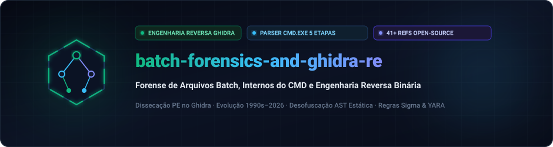
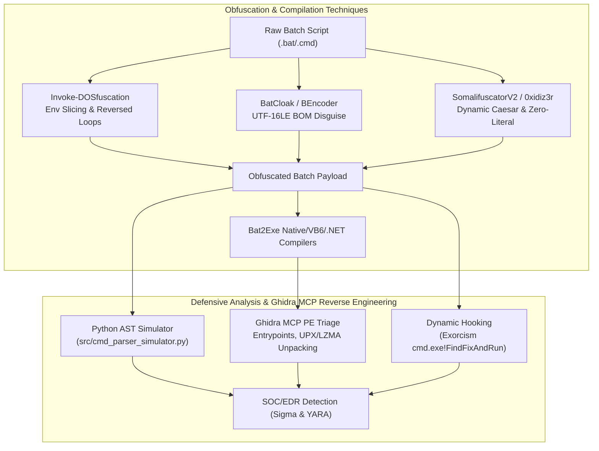

  <a href="../../README.md">🇺🇸 English</a> · <a href="./ko.md">🇰🇷 한국어</a> · <a href="./zh-CN.md">🇨🇳 中文</a> · <a href="./es.md">🇪🇸 Español</a> · <a href="./hi.md">🇮🇳 हिन्दी</a> 
  <a href="./ar.md">🇸🇦 العربية</a> · <strong>🇧🇷 Português</strong> · <a href="./ru.md">🇷🇺 Русский</a> · <a href="./fr.md">🇫🇷 Français</a> · <a href="./id.md">🇮🇩 Bahasa Indonesia</a>

  

# 🛡️ batch-forensics-and-ghidra-re

**Forense de Arquivos Batch, Internos do CMD e Engenharia Reversa Binária**

Engineered &amp; Audited by **[Maya Thorne](https://github.com/maya-thorne)** · Systems &amp; Reverse Engineering Research

---

## 📚 Master Technical Documentation

1. 🔬 **[01_DEEP_REVERSE_ENGINEERING_AND_SOURCE_ANALYSIS.md](../01_DEEP_REVERSE_ENGINEERING_AND_SOURCE_ANALYSIS.md)**
   - **Ghidra MCP PE Binary Reverse Engineering**: `bat2exe_12.exe` (UPX Native Stub `0x20ea0`), `BEDeCode.exe` (VB6 Native `ThunRTMain` `0x1670`), `example.exe` (.NET CLR `0x337e`), `example_bytepressed.exe` (LZMA RangeCoder).
   - **5 Core Tools Source Code Dissection**: `Invoke-DOSfuscation`, `SomalifuscatorV2`, `batch_deobfuscator`, `Exorcism` (`cmd.exe!FindFixAndRun` Hook), `0xidiz3r`.
2. 📖 **[02_CLASSIC_TO_MODERN_EVOLUTION_1990_2026.md](../02_CLASSIC_TO_MODERN_EVOLUTION_1990_2026.md)**
   - 30-Year Evolution from MS-DOS ASCII techniques to 2026 AI/LLM Deobfuscation models.
3. 🛡️ **[03_BATCLOAK_MULTI_STAGE_LOADER_FORENSICS.md](../03_BATCLOAK_MULTI_STAGE_LOADER_FORENSICS.md)**
   - Multi-Stage forensic analysis of BatCloak / ScrubCrypt obfuscated loaders and EDR telemetry.
4. 📑 **[04_BATCH_OBFUSCATION_ENCYCLOPEDIA.md](../04_BATCH_OBFUSCATION_ENCYCLOPEDIA.md)** & **[05_BATCH_OBFUSCATION_MASTER_GUIDE.md](../05_BATCH_OBFUSCATION_MASTER_GUIDE.md)**
   - Theoretical taxonomy and comprehensive detection framework.

---

## 🏗️ Architecture & Defensive Verification

